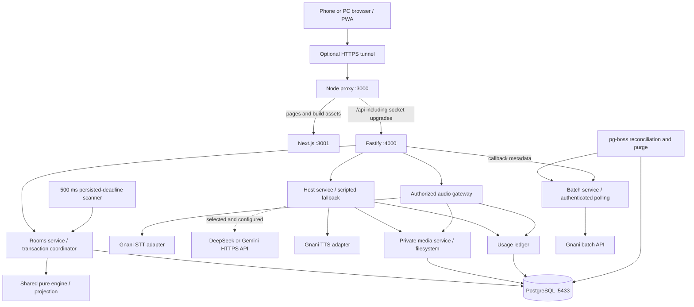

# Architecture and system connections

## Interactive host update — 4 November 2026, B045

Online flow 2 separates `HostDirector` orchestration, `AnswerPreparation` translation and `GnaniProviders` transport. PostgreSQL owns claims/exchanges/deadlines and room memory; immediate dispatch plus due-only pg-boss jobs drive the host. Provider work occurs outside transactions and publication checks run/phase/turn identity. Captions arrive over protocol-4 room state; private audio sockets carry PCM and completed speech segments; an authenticated endpoint returns translations; one authenticated audio asset serves each host utterance. Shared rules remain the sole scoring authority. [Current specification](INTERACTIVE_HOST.md) replaces the legacy Tap-to-ask-only description below for new runs.

Audited 31 October 2026. Start with [status](STATUS.md); the exact relational model and retention limits are in [database](DATABASE.md).

The backend is authoritative. Phones submit intents and render permitted snapshots. Offline demo sessions retain their local simulator and protocol 2; real rooms use protocol 3 and never advance offline.



One backend process owns socket delivery and in-process narration cache. PostgreSQL owns durable membership, controller leases, deadlines and game state. Redis, multi-instance fan-out, object storage and production deployment remain later work.

The engine has **no database or network dependency**: it returns state and player-specific projections. `Rooms` persists those results. The root runners bind the proxy, Next.js and Fastify to loopback; the optional tunnel supplies phone HTTPS access. `scripts/proxy.mjs` routes `/api/` to Fastify and everything else to Next.js, including WebSocket upgrades. Next.js does not implement the game API.

## Module connections

| Boundary                 | Source and responsibility                                                                                                                                                                |
| ------------------------ | ---------------------------------------------------------------------------------------------------------------------------------------------------------------------------------------- |
| App / browser services   | [SessionProvider](../frontend/src/session/provider.tsx) selects online/demo/developer session, audio adapter, preferences, feedback and wake lock                                        |
| Online transport         | [NetworkSession](../frontend/src/session/network-session.ts) establishes cookie identity, create/join/resume, socket ownership, pending intents, acks and snapshots                      |
| Screen rendering         | [Game](../frontend/src/features/game.tsx) dispatches the permitted phase through the screen registry; components send intents, never calculate authoritative scores                      |
| REST / socket boundary   | [server.ts](../backend/src/server.ts) validates origins, identity, requests/messages and routes them to services                                                                         |
| Game coordinator         | [rooms.ts](../backend/src/rooms.ts) owns transactional membership, controller leases, action receipts, progression and projection                                                        |
| Pure rules/content       | [engine.ts](../shared/src/game/engine.ts), [definitions.ts](../shared/src/game/definitions.ts), [packs.ts](../shared/src/game/packs.ts), [spotlight.ts](../shared/src/game/spotlight.ts) |
| Database                 | [schema.ts](../backend/src/db/schema.ts), [migrations](../backend/migrations); full private state plus selected action/metric projections                                                |
| Voice / providers        | [audio.ts](../backend/src/audio.ts), [host.ts](../backend/src/host.ts), [providers.ts](../backend/src/providers.ts); backend-only credentials                                            |
| Artifacts / jobs / costs | [media.ts](../backend/src/media.ts), [batch.ts](../backend/src/batch.ts), [jobs.ts](../backend/src/jobs.ts), [usage.ts](../backend/src/usage.ts)                                         |

## One action through the system

```mermaid
sequenceDiagram
  participant UI as Player screen
  participant Client as NetworkSession
  participant API as Fastify / Rooms
  participant Engine as Shared engine
  participant DB as PostgreSQL
  UI->>Client: Lock answer
  Client->>API: intent with cid, runId, stepId, phaseEpoch
  API->>DB: Begin transaction; lock room; check receipt/ownership
  API->>Engine: Catch up time; validate/apply action
  Engine-->>API: New state / score events
  API->>DB: Persist state, projections and receipt; commit
  API-->>Client: Ack and permitted snapshot (either order)
  Client-->>UI: Locked after acceptance and matching revision
```

On restart, persisted state/deadlines remain. Startup and a 500 ms scanner catch up under room locks; this is **not one durable job per game deadline**. pg-boss is used for batch reconciliation and purge. Reconnect sends `lastRevision`, but the current server always returns a fresh full permitted snapshot; it does not replay event deltas.

## Transaction boundary

Submitted game intents lock the room row, load its current match and check seat ownership. The match snapshot, applicable action projections, score events, transition metadata and intent receipt commit together. Scheduled progression also runs under the room lock. No provider request occurs while holding this transaction.

The action identity is `(run_id, seat_id, cid)`. Replaying the same payload returns its original acknowledgment; reusing an ID for different content fails. Unique score keys prevent catch-up/retry double awards. A rejected stale payload cannot earn points; resolving elapsed deadlines during that request can still legitimately advance the match. Provider operations reserve their budget under a match-row lock and use separate attempt records.

Matches snapshot flow definitions, rules, content/aliases and opaque Bluff answer IDs; versions also record the `host-v1` prompt label. That label does not provide runtime dispatch to old host implementations, and provider model configuration is read from the running backend, not frozen per match. Add explicit version dispatch or drain active matches before an incompatible engine/prompt deployment. This release has no general multi-version engine loader.

## Persistence model

The private `game_runs.state` snapshot is the recovery source. `game_events` stores transition metadata, not a complete replayable action stream. Human action tables, round snapshots and score records are written alongside it. See the [actual FK diagram and table inventory](DATABASE.md) for the distinction between declared constraints and application-only references.

`rate_cards` independently versions provider/model/unit/currency prices. Each attempt stores its rate snapshot. `model` is requested; nullable `effective_model` is populated only when the provider confirms it. Missing billing, pricing or model evidence stays unknown.

Actions reference a room seat, not array position or a fictional player. Traits, friend ratings, nominations, catchphrases, submissions and card decisions are per seat. Friend-rating targets use a seeded cyclic rotation. Rematches create a new game run and retain membership. Cards require their subject's explicit approval; a scripted replacement cannot approve them.

## Privacy and presence

Guest credentials are random opaque tokens stored as hashes. HttpOnly, SameSite=Strict cookies become Secure on HTTPS. Socket origins are allowlisted. Connection UUIDs grant a single writer lease; a second tab must explicitly take over and revokes the old writer.

Lobby removal uses `room_members.removed_at` as a durable membership revocation. Removed rows retain room/guest uniqueness to prevent that identity rejoining. Active roster queries, resume lists and content authorization exclude them. The same room transaction commits the rebuilt pre-game snapshot and removal receipt; a replacement receives a new seat. In-game rosters remain frozen. Backgrounding a tab stops media, while a live socket retains ownership until explicit leave, socket failure or heartbeat expiry.

Private projections hide factual locks, submission authors, truth/AI markers and other players' pre-reveal voices. Bluff option IDs are random UUIDs, not derived from player IDs. Public host context includes only names, scores, mode and phase. Speech vocabulary hints contain public names only.

Disconnects reserve seats. Grace is 15 seconds or the action deadline. Missing actions use deterministic scripted choices and consume zero LLM calls; already-locked human actions survive. Rejoining before a stand-in acts restores control; after it acts, control returns next question. The earliest joined connected human becomes host after grace. A persisted deadline worker catches up after restart; no human card is automatically approved.

## Retention and scope

Match access/ordinary shared audio expires after two hours; content purge runs at seven days; diagnostic recordings/results have at most 24 hours; run-associated usage metrics have 90 days. These windows do **not** automatically erase guest profiles or room/code rows. The [retention table](DATABASE.md#retention-as-implemented) identifies all current stores and gaps.

Recordings awaiting submission and ordinary private playback stay in browser memory. A reveal upload requires an accepted answer and separate consent. Diagnostic audio is separate and never made public through reveal consent. The static narration cache contains only built-in dialogue and expires after one hour/process restart.

Provider deletion is not guaranteed by local purge. Gnani retention and cancellation/billing behavior need account confirmation. Development databases/backups must follow this policy before adding backups or replication. Metrics record playback as client-reported elapsed time, not authoritative proof of listening.

## Adaptive browser lifecycle update — 2026-11-03

`MatchNavigation` owns leave confirmation and sheet-aware Back handling. CSS preserves one game tree while adapting panes. `TabCoordination` exchanges owner/probe/release metadata; `NetworkSession` still relies on the backend lease and stops retries after takeover. `answer-draft.ts` stores only unfinished tab-local text and reconciles it against a recovered permitted snapshot. `ClipFeed` coalesces media invalidations and cancels inactive fetches; media remains authenticated and uncached. Backend room fanout shares one committed load while preserving per-seat projections. No database table or migration changed. See [adaptive app](ADAPTIVE_APP.md) for evidence and remaining device checks.
