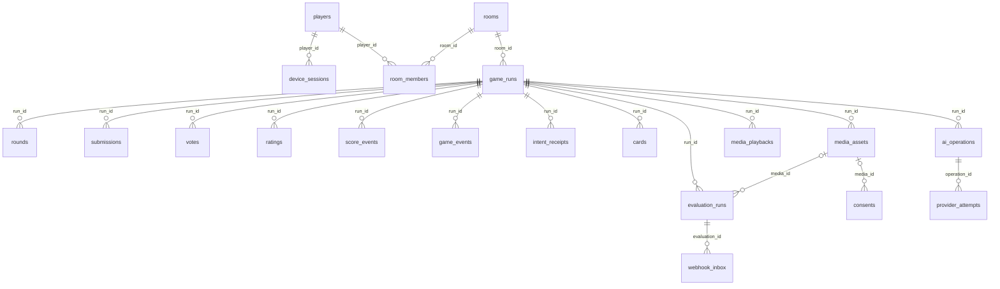

# Database and data ownership

## Browser Void profiles — 9 November 2026, B071

No schema migration is required. `gc2_accounts.google_sub` also accepts server-generated `guest:<uuid>` identities for Void; account/login insertion is atomic. `gc2_logins` stores the hash of a random guest bearer cookie with a 180-day expiry. Shared Google auth and the admin operator reject guest subjects; Void fixes guest role to player. Existing session/audio/transcript/graph foreign keys therefore provide the same ownership isolation for guests. Preferences identifying voice mode/language stay in the browser. Saved conversation content remains in PostgreSQL and the private media directory, not browser localStorage. Explicit guest logout revokes access but does not delete content; history deletion uses the existing durable purge path. Legacy local/synthetic/Google data is not reassigned.

## Account and graph migration — 9 November 2026, B069

Additive migrations 0009–0011 preserve existing `gc2_accounts` IDs and Void ownership. Shared accounts gain roles, preferences and versioned onboarding; new account tables persist guest links, verified score summaries and approved/imported cards. GC2 gains normalized transcript turns, versioned analysis records, provenance-aware graph nodes/edges, 768-dimensional array embeddings, approved-summary revisions, cluster snapshots and safe job timing/outcome fields and durable queue-delivery receipts. Deletion immediately excludes evidence and cascades derived rows through durable purge. No database reset or pgvector installation occurred. See [table ownership and retrieval rules](ACCOUNTS_AND_STORY_GRAPHS.md). Legacy local-test records remain unclaimed and cannot authenticate.

## Local Void identities — 7 November 2026, B065

Local testing stores random `local-test:` subjects in `gc2_accounts.google_sub`, separate from real Google subjects. Account and login are created in one transaction. Existing foreign keys, private session ownership and deletion apply; no migration is needed. The cookie identifies the browser, not a cross-device account. Local identities are rejected when local testing is disabled or on a public origin.

## GC2 — 7 November 2026, B064

Migrations 0007/0008 add separate accounts, login/OAuth attempts, sessions, assets, jobs and daily usage fields. Session JSON deliberately retains accepted raw transcripts, audio references and processed evidence until deletion, as approved for The Void. Private GC2 storage is separate from Game 1 media expiry. Tombstones immediately exclude content; durable purge removes files/rows and invalidates dependent memories. Provider calls execute outside per-account/session transactions. See [The Void](THE_VOID.md) for retention, crash recovery and deployment requirements.

## Voice input state - 5 November 2026, B051

No SQL migration is required. New run JSON persists `voiceInputVersion: 2`; rematches receive version 2, while older JSON without it projects legacy voice limits/manual behavior. First-audio acceptance increments existing per-epoch/per-seat (or per-host-turn) recording counters under the room/run transaction. Preparation does not increment them. Capture IDs scope pending finalisation and usage operations; duplicate operation keys, stale phase/run results and lost ownership are rejected. The existing one-time phase voice grace remains server-owned. A short `voicePlayback` lease in run JSON coordinates same-room AI playback, expires after lost heartbeats and clears on phase changes. Provider requests run outside transactions. Existing old-media expiry is retained; player clip uploads are retired. Host memory, scoring and authored-question history are unchanged.

## Guided game persistence — 5 November 2026, B048

Migration `0006_guided-game.sql` adds `rooms.question_history`, retained on rematch and cleared on end/expiry. Run JSON stores narration/deadlines, prepared audio references, per-run question history and selected Bluff IDs. Claims and publication use room locks; providers run outside transactions. Operation keys prevent duplicate accepted narration charges. Appearance updates atomically update room/player profiles. [Details](ROOMS_AND_GUIDED_VOICE.md).

## Interactive host migration — 4 November 2026, B045

Migration `0005_interactive-host.sql` adds `rooms.host_memory` JSONB with an empty-array default. It was applied locally to development and test databases. It stores up to 12 callbacks with evidence, involved seats and use times. Rematches preserve it; end-room/expiry clear it; removed-seat callbacks are excluded from context.

Versioned run JSON now persists host exchanges/deadlines/checkpoints, reply receipts/body hashes, recording counts, voice grace, translation preparations, original/confirmed sources and input outcomes. These fields do not change existing score tables. The existing operations/attempts ledger has separate host/translation unit reservations. Provider calls run outside row-lock transactions; claims and publication revalidate run/phase/turn. The existing pg-boss infrastructure dispatches due host work with room singleton keys. [Current specification](INTERACTIVE_HOST.md) describes retention and duplicate/stale handling. Metadata counts below remain dated historical observations.

**3 November 2026 character update:** no migration. `players.avatar` remains an integer; profile/seat/card snapshots keep their existing avatar and colour fields. Customised appearance IDs occupy 4–560003, with 0–3 reserved for legacy presets. Five backgrounds are supported by the frontend/setup schema. Guest creation, room persistence and another guest's roster view are transactionally tested. Appearance format details are in [Frontend](FRONTEND.md).

Code audit: **31 October 2026**. Authoritative definitions: [Drizzle schema](../backend/src/db/schema.ts), [SQL migrations](../backend/migrations), [room persistence](../backend/src/rooms.ts), [purge jobs](../backend/src/jobs.ts). Development metadata confirms **21 application tables** and **five applied migrations** on PostgreSQL 17.11. See [sanitized metadata](../work-log/verification/2026-10-31-documentation-metadata.json).

## Identities and relationships

`players.id` identifies a guest device identity. `room_members.id` identifies that identity's **seat in one room**. Most game fields named `playerId`, `ownerId` or `subjectId` actually carry a **seat UUID**; they do not point to the global player row. The server resolves the cookie identity to a seat before allowing an action.

The following diagram shows declared SQL foreign keys only. Additional logical references are described below.

`rate_cards` is independent: each attempt stores a JSON pricing snapshot, not a foreign key to the active rate. `rooms.current_run_id`, action seat IDs, `cards.subject_id`, `media_assets.owner_id`, `consents.player_id`, and playback seat/media IDs have **no declared FK**. These are checked or resolved by application code. `submissions` and `votes` carry run/step/epoch identifiers, not a `round_id` FK. Do not interpret the conceptual room → match → round → action model as a fully constrained relational chain.

## Table inventory

| Tables                               | What is stored and how it is used                                                                                                                                                                                                                   |
| ------------------------------------ | --------------------------------------------------------------------------------------------------------------------------------------------------------------------------------------------------------------------------------------------------- |
| `players`, `device_sessions`         | Name/avatar/color, SHA-256 hash of an opaque credential, 30-day expiry. Raw credential is only in the HttpOnly cookie; no password/signup. Session deletion/expiry is the revocation mechanism; no `revoked_at` field or public revocation endpoint |
| `rooms`, `room_members`              | Generated unique room code, setup, current match pointer, expiry, profile copy, controlling connection UUID/lease, lobby `removed_at`. Unique `(room_id, player_id)` prevents a kicked identity reclaiming a seat                                   |
| `game_runs`                          | Authoritative private engine JSON, revision, deadline, status, versions, seat count/mode, started/completed times, first departure phase, resume/content expiry                                                                                     |
| `rounds`                             | Upserted private round JSON for Spotlight or Bluff, unique `(run_id, round_index)`                                                                                                                                                                  |
| `submissions`                        | Accepted human `submit`, `traits`, `nominate`, `predict`, `skip` intent payloads; unique `(run_id, seat_id, step_id, epoch)`                                                                                                                        |
| `votes`                              | Human vote option IDs with the same run/seat/step/epoch uniqueness                                                                                                                                                                                  |
| `ratings`                            | Self and assigned-friend rating arrays, unique `(run_id, rater_id, target_id)`                                                                                                                                                                      |
| `score_events`                       | Scoring reason, points, seat, round, human/AI attribution; unique `(run_id, event_key)`                                                                                                                                                             |
| `game_events`                        | Revision-ordered transition metadata: step ID, epoch, deadline. **Not full action history or state snapshots**                                                                                                                                      |
| `intent_receipts`                    | Intent ID, body hash, accepted/rejected ack and revision; unique `(run_id, seat_id, cid)`                                                                                                                                                           |
| `cards`                              | Per-subject generated card data and approval timestamp, unique `(run_id, subject_id)`; generated PNG remains a client download                                                                                                                      |
| `media_assets`, `consents`           | Private-file key, owner seat, kind, WAV metadata, expiry and current consent flags; explicit consent updates append history keyed by guest identity                                                                                                 |
| `media_playbacks`                    | UUID-deduplicated, duration-bounded client reports. Reports are not proof a human heard audio                                                                                                                                                       |
| `ai_operations`, `provider_attempts` | Per-run reservations/idempotency; attempts with requested/effective model, usage evidence, status, latency, provider ID and cost fields                                                                                                             |
| `rate_cards`                         | Versioned provider/model/unit/currency prices and effective dates. No rates were present at audit time                                                                                                                                              |
| `evaluation_runs`, `webhook_inbox`   | Consented diagnostic job metadata/results/reference text and hashed callback token; deduplicated callback event metadata, never callback transcript bodies                                                                                          |

`game_runs.state` also stores presence, completions, nominations, catchphrases, defenses, chat, approvals, scores, content and host conversation state. Automated stand-in/timeout actions change this snapshot and derived rounds/scores; they are not all inserted as human submission rows. There is no replay-from-events implementation.

## Accepted-action transaction

1. Lock the room row (`SELECT ... FOR UPDATE` in `Rooms.load`), then load its current run and active members.
2. Verify controlling connection and match. Find a prior receipt by run/seat/intent ID; same hash returns the prior ack, different hash rejects ID reuse.
3. Resolve elapsed deadlines, validate step/epoch/controller/role, apply the pure engine.
4. Persist resulting snapshot/revision/deadline, relevant human action projection, derived rounds/scores/cards, transition metadata and receipt in the same transaction. Rejected actions also receive receipts; elapsed time may still legitimately update state.
5. After commit, publish each seat's permitted snapshot and its ack. Provider work is outside the room transaction.

Unique score keys and round `scored` flags prevent repeat awards. Provider budgets use a separate run-row lock. Rematch creates a new run and resets scores/readiness while preserving room membership and the latest 50 room chat messages. Resume time is **two hours from run creation, including lobby time**, not two hours after pressing Play.

Files and SQL are not one atomic transaction: media writes the file first and removes it if insertion fails; deletion removes the file then metadata. The purge also prunes unreferenced files older than one hour. A future object-store implementation must preserve these cleanup semantics; only `PrivateFilesystem` exists now.

## What lives outside PostgreSQL

| Location                        | Contents                                                                                                                                                      |
| ------------------------------- | ------------------------------------------------------------------------------------------------------------------------------------------------------------- |
| Backend private media directory | Consented diagnostic/reveal WAVs and generated host audio. `MEDIA_ROOT` is resolved against backend cwd; never under frontend `public/`                       |
| Backend process                 | Active sockets, abort controllers, one-hour static narration audio cache; lost on restart                                                                     |
| Browser memory                  | Unsubmitted text/recording drafts, ordinary recordings/private playback, pending network intents; refresh loses these                                         |
| Browser local storage           | Profile/bio/settings, up to 12 explicitly saved approved cards; offline-demo checkpoint and play-mode preference. No online game authority or credential here |
| Browser HttpOnly cookie         | Opaque guest credential. Name and room code alone cannot recover it                                                                                           |
| Service worker cache            | Public shell/build assets; no API responses or recordings                                                                                                     |
| Download directory              | Approved PNG exports. Server deletion cannot remove device files                                                                                              |

## Retention as implemented

| Data                                                                                                 | Current cleanup/access behavior                                                                                                                  |
| ---------------------------------------------------------------------------------------------------- | ------------------------------------------------------------------------------------------------------------------------------------------------ |
| Online resume and reveal/host audio                                                                  | Access expires at the two-hour run window; minute-scheduled purge deletes expired media files/rows                                               |
| Diagnostic recording/results/reference                                                               | Explicit opt-in, at most 24 hours; revocation clears evaluation results and requests provider cancellation. Expiry deletes evaluation/inbox data |
| Private state, rounds, submissions, votes, ratings, score events, cards, receipts, transition events | Seven-day purge clears state/versions/deadline and deletes these child rows. Room profile copies are removed once no unexpired content remains   |
| Provider/cost/playback metrics                                                                       | Run rows older than 90 days are deleted, cascading their metrics. No raw answers/audio are intended in usage records                             |
| Credential sessions                                                                                  | Expired `device_sessions` rows deleted after their 30-day window                                                                                 |
| Guest profiles, expired room records, rate cards                                                     | **No automatic deletion policy in current code.** Expired rooms have setup cleared; `players` name/avatar/color and room/code rows remain        |
| Saved local profile/cards                                                                            | Remain on the device until locally removed/reset; independent of server retention                                                                |

Initial diagnostic capture sets the asset's consent flag but does not append an initial grant to `consents`; that table records the subsequent consent-update endpoint. Full consent chronology remains follow-up work.

Purge tests cover fixture cleanup, not a deployed backup/archive system. No backup policy, restore exercise, guest-erasure API or provider-side erasure guarantee is implemented. At diagnostic expiry, provider cancellation is best effort before local deletion; successful cancellation is not guaranteed. The in-process narration cache contains built-in dialogue only and is cleared on expiry/process restart.

## Migrations and operation

| Migration                         | Change                                               |
| --------------------------------- | ---------------------------------------------------- |
| `0000_black_shatterstar.sql`      | Initial schema                                       |
| `0001_small_tag.sql`              | Nullable effective provider model evidence           |
| `0002_omniscient_moon_knight.sql` | Playback measurement table and departure-phase field |
| `0003_colorful_blur.sql`          | Actual match-start timestamp                         |
| `0004_lobby-removal.sql`          | Durable lobby membership removal                     |

Apply with `npm run db:migrate` from the workspace root. Drizzle records applied migrations in its own schema; pg-boss maintains its own job schema/queues. The integration suite migrates and truncates only the dedicated `expose_test` database. Schema/migration files are version-controlled; there is no automated rollback command. Do not regenerate or delete databases to resolve a documentation discrepancy.

## November 3 lifecycle update

No database migration: existing room-member connection ownership and leases remain authoritative. A broadcast batch reads the committed room/run/members once per transaction and validates each recipient against that data. Unsubmitted refresh drafts are tab-scoped browser text, not new database records. Media invalidations are best-effort socket metadata; authenticated list revalidation on reveal/reconnect is the recovery path.

B035 (3 November 2026): no migration. Duplicate-name labels are computed from member profile copies when rebuilding the pre-game roster. Guest identity and seat UUIDs remain the authority; names never authenticate a player. Post-game chat is persisted with normal intent receipts/events and copied transactionally into a rematch snapshot. This is bounded room history, not an unlimited chat archive; copied content follows the new snapshot retention window.
